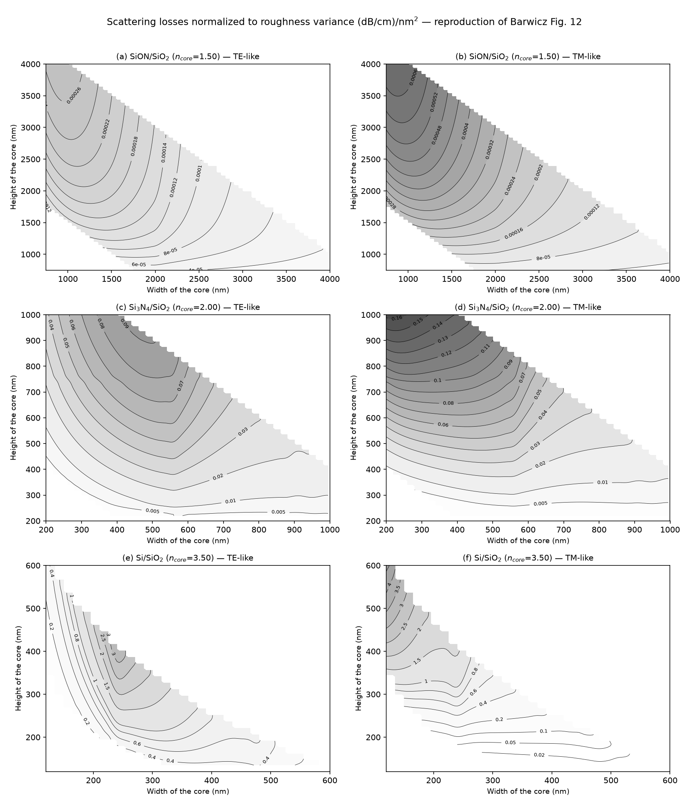

# waveguide_scattering

A 3-D model of scattering loss from sidewall roughness in rectangular dielectric
waveguides, valid at any index contrast and for either polarization.

This is the original research code behind

> T. Barwicz and H. A. Haus, "Three-Dimensional Analysis of Scattering Losses
> Due to Sidewall Roughness in Microphotonic Waveguides," *Journal of Lightwave
> Technology*, vol. 23, no. 9, pp. 2719–2732, September 2005.
> [doi:10.1109/JLT.2005.850816](https://doi.org/10.1109/JLT.2005.850816)

made runnable again and packaged so that its results can be reproduced.


## What it does

Sidewall roughness scatters light out of a waveguide. The standard way to
estimate how much is a two-dimensional analysis (Payne–Lacey and its
descendants), applied to a rectangular waveguide via the effective-index
method. That approach assumes the radiation pattern of a planar slab, which a
rectangular waveguide does not have — so it cannot capture how the waveguide
*cross-section* shapes the radiation, and it substantially overestimates loss
for small cores.

This model treats the roughness as a volume current source and computes the
actual three-dimensional radiated power, using array factors to keep the
integrals tractable. The headline result is that a 2-D analysis can overestimate
the loss of a small high-index-contrast waveguide by more than an order of
magnitude, and that scattering loss is strongly polarization-dependent.

Given a waveguide cross-section and roughness statistics, you get a predicted
propagation loss in dB/cm.



*Scattering loss normalized to roughness variance, for the three material
systems of the paper — a reproduction of its Fig. 12, regenerated end to end by
the code in this repository. [Fig. 11](figures/fig11_reproduction.png) is the
accompanying radiation-efficiency map.*

## Attribution

The model and all of the numerical code are **Tymon Barwicz's**, written at MIT
in 2004–2005 for the paper above, with Hermann A. Haus. Tymon provided the source code.

**Gavin West** identified the working subset among the files provided,
got it running under GNU Octave, regenerated the datasets, and assembled this
repository.

`adaptlob.m` is Walter Gautschi's adaptive Lobatto quadrature (1998), after
Gander, *Computermathematik*, Birkhäuser, 1992.

See [NOTICE.md](NOTICE.md) for file-by-file provenance.

## The mode solver is not included

Turning a waveguide cross-section into something this model can integrate needs
a 2-D full-vector mode solver. The one used for the paper was written by
**Milos Popovic** and is not included here.

This affects only the first stage. **Precomputed stage-1 output for all three
material systems of the paper ships in `data/`**, so the scattering model itself
and every figure in the paper can be reproduced here with no mode solver at all.

You need your own solver only to model a waveguide that is not in the shipped
sweeps. Two stub files mark where it plugs in; see
[docs/modesolver_interface.md](docs/modesolver_interface.md).
For other matlab-based modesolvers, I've used [WGModes](https://photonics.umd.edu/software/wgmodes/) in the past with good results.


## Quick start

Requires GNU Octave 11 or MATLAB. From the repository root:

```octave
% ~1 minute: predict the loss of one waveguide, and check it against the paper
cd examples; example1_loss_lookup
```

```
Si/SiO2 waveguide, lambda = 1550 nm, exponential roughness, Lc = 50 nm
  core             : 200 nm high x 400 nm wide
  polarization     : TE-like (fundamental)
  roughness        : sigma^2 = 10 nm^2

  Fig. 12 quantity : 0.6667 (dB/cm)/nm^2
  Fig. 11 quantity : 0.1197  (3-D loss / 2-D Payne-Lacey loss)
  -> SCATTERING LOSS = 6.67 dB/cm

  paper, Fig. 12 caption : "around 7 dB/cm"
  AGREES with the published value.
```

## Examples

| example | what it shows | runtime | needs a mode solver |
|---|---|---|---|
| `example1_loss_lookup.m` | a loss prediction in dB/cm, checked against the paper | ~1 min | no |
| `example2_single_cell.m` | the model actually running — what goes in, what comes out | ~30 s/cell | no |
| `example3_reproduce_fig11_fig12.m` | all twelve panels of Figs. 11 and 12 | ~8 min | no |
| `example4_validate_stage1.m` | checking a solver you have plugged in | ~2 min/row | **yes** |

`examples/plot_fig11_fig12.py` renders the publication-quality composites from
example 3's output; it is what produced the images in `figures/`. Use it if your
Octave build cannot print headless (a common failure — Octave's OpenGL toolkits
write black frames with no display attached, and example 3 therefore prefers the
gnuplot toolkit).

## How it works

Three stages, each writing a `.mat` file the next one reads.

**Stage 1 — boundary fields.** `boundary_fields_{Si,Si3N4,SiON}*.m` sweep a grid
of core heights and widths, solve each cross-section for its two lowest-order
modes, sort them into TE-like and TM-like, locate the sidewalls, and reduce each
mode to the sidewall integrals the model needs. *This is the stage that needs a
mode solver.*

Remarkably little survives this stage: no field maps are stored, just three
numbers per polarization per cross-section — the propagation constant, the
sidewall field intensity normalized to guided power, and the
longitudinal-to-transverse intensity ratio on the sidewall. A 2711-cell sweep is
339 KB. See [docs/data_format.md](docs/data_format.md).

**Stage 2 — radiated power.** `scat_hic_integral_final_v3.m` integrates the
far-field radiation profile of the equivalent roughness current over all
scattering directions, for each cell, by adaptive Lobatto quadrature over six
Mathematica-exported integrands. It also evaluates the 2-D Payne–Lacey loss
(`scat_3d_payne.m`) as the reference denominator for Fig. 11. Roughness is
assumed exponentially correlated with `Lc = 50 nm`; loss is reported per unit
roughness variance. This is the expensive stage.

**Stage 3 — maps.** `scat_hic_interpolate_{Si,Si3N4,SiON}.m` resample the
triangular sweep onto a rectangular height/width mesh and spline-interpolate,
producing the Fig. 11 and Fig. 12 panels.

## Cost

Measured on a 4-core desktop under Octave, for the three sweeps of the paper:

| system | cells | stage 1 (mode solve) | stage 2 (integration) |
|---|---|---|---|
| Si/SiO₂ | 353 | ~1.7 h | ~2.9 h |
| Si₃N₄/SiO₂ | 1130 | ~2.8 h | ~3 days |
| SiON/SiO₂ | 2711 | ~4.7 h | ~2.3 days |

Stage 3 takes a minute or two.

Stage 2 dominates, and gets worse as index contrast falls: each cell runs about
nine adaptive double quadratures, and when the modal β approaches the cladding
`k` the roughness spectrum's Lorentzian peak moves inside the integration
domain and forces deep refinement.

It is embarrassingly parallel across cells though. Nothing couples one cell to
another. `src/waveguide_scattering/parallel/` holds a sharded worker and a
merger for that and the worker's per-cell body is a verbatim transcription of the
serial function and was validated bit-exact against it. Launch N workers with
`OMP_NUM_THREADS=1` (the quadrature is interpreter-bound, and Octave's OpenBLAS
threads otherwise busy-wait across all cores), give each an interleaved subset
of rows, then merge. The Si₃N₄ and SiON results shipped here were produced that
way.

**All of this is already done.** The shipped `data/integrated/` files are the
output of those runs, which is why example 3 reproduces every panel in about
eight minutes.

## Repository layout

```
src/waveguide_scattering/   the model (GNU Octave / MATLAB)
  boundary_fields_*.m         stage 1 - sweep drivers (need a mode solver)
  modesolve_cross_section.m   stage 1 - mode solver plug-in point (stub)
  mode_power.m                stage 1 - power normalization plug-in point (stub)
  scat_hic_integral_final*.m  stage 2 - the scattering model
  scat_hic_integrant_*.m      stage 2 - the six far-field integrands
  scat_3d_payne.m             stage 2 - 2-D Payne-Lacey reference
  adaptlob.m                  stage 2 - adaptive Lobatto quadrature
  scat_hic_interpolate_*.m    stage 3 - loss maps
  parallel/                   stage 2 - sharded worker and merger

data/
  boundary_fields/            stage-1 output: 3 systems, 4194 cross-sections, 521 KB
  integrated/                 stage-2 output: the computed losses, 1.2 MB

examples/                     four worked examples, smallest first
docs/                         data format, mode-solver interface, validation
figures/                      the reproduced Figs. 11 and 12
```

Total shipped data: **1.7 MB**.

## Validation

The 2005 MATLAB reproduces under Octave to ~1e-16 for stage 2 and bit-exactly
for stage 3; a fully regenerated pipeline reproduces the published maps to a
worst case of ~2.5%, localized at the degenerate square-core diagonal where the
TE/TM assignment is arbitrary. All twelve panels of Figs. 11 and 12 were
regenerated for all three material systems.

Details, including the four Octave porting fixes (none of which changes a
computed value), are in [docs/validation.md](docs/validation.md).

## Scope and caveats

- **Leading order only.** The analysis is first-order in the roughness
  amplitude. The paper argues against going further, on the grounds that the
  roughness spectral density is hard enough to measure accurately in the first
  place.
- **Loss scales as σ².** Results are reported per unit roughness variance, so
  rescaling for a different amplitude is a multiplication. Changing the
  *correlation length* is not — `Lc = 50 nm` is baked into the shipped stage-2
  results, and a different value means rerunning stage 2.
- **Sidewalls only.** Top and bottom surfaces are assumed smooth, which is the
  usual situation for a deposited-then-etched waveguide.
- **Straight waveguides.** No bends. It gets... complicated.
- **The code is 2005 research code**, kept deliberately unmodified apart from the
  minimum needed to run it under Octave. It is
  hard-coded, repetitive in places, and the sweep drivers carry their geometry
  as literals near the top. It has not been refactored, really my goal here was reproducability. A more modern, Python-based implementation is in the works.
- **Possible erratum.** The paper notes it believes a factor of 2 may be missing
  from eq. (16a) of the 2-D analysis it uses as its reference. That affects the
  Fig. 11 normalization, not the absolute losses of Fig. 12.

## Citation

If you use this model, cite the paper:

```bibtex
@article{barwicz2005,
  author  = {Barwicz, Tymon and Haus, Hermann A.},
  title   = {Three-Dimensional Analysis of Scattering Losses Due to
             Sidewall Roughness in Microphotonic Waveguides},
  journal = {Journal of Lightwave Technology},
  volume  = {23},
  number  = {9},
  pages   = {2719--2732},
  year    = {2005},
  doi     = {10.1109/JLT.2005.850816}
}
```

## License

[MIT](LICENSE), © Tymon Barwicz and Gavin West.

One exception: `src/waveguide_scattering/adaptlob.m` is Walter Gautschi's
adaptive Lobatto quadrature, carried over from the original source tree with an
attribution line but no license grant, and redistributed on that basis. Tymon had to modify a few lines in it, which is why there's a hard-coded version included. The MIT
grant does not extend to it. See [LICENSE](LICENSE) and [NOTICE.md](NOTICE.md).
